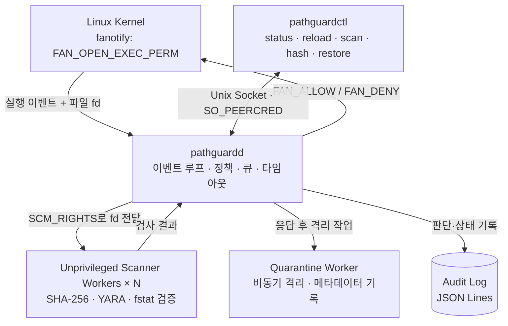

# PathGuard

### Linux Endpoint Execution Protection Agent

**PathGuard**는 Linux에서 실행 파일이 실행되기 직전 이를 검사하고, 정책에 따라 **실행 허용·차단·감사 기록·격리**를 수행하는 엔드포인트 보안 에이전트입니다.

Linux 커널의 `fanotify(FAN_OPEN_EXEC_PERM)`를 이용해 실행 허가 시점에 개입하며, **SHA-256 해시 기반 정책**과 **YARA 시그니처 검사**를 결합합니다. 검사 로직은 권한을 낮춘 별도 워커 프로세스에서 실행하고, 운영 상태와 판단 근거를 JSON Lines 감사 로그로 남깁니다.

> **프로젝트 성격:** EPP(Endpoint Protection Platform)의 핵심 메커니즘을 직접 구현·검증하기 위한 **Linux 보안 엔지니어링 프로젝트**입니다. 상용 EPP의 모든 보호 기능을 제공하거나 운영환경 전체의 악성코드 실행 방지를 보장하지는 않습니다.

**Tech Stack** · `C++17` · `Linux fanotify` · `libyara` · `OpenSSL (SHA-256)` · `Unix Domain Socket` · `systemd` · `CMake`

---

## 1. 프로젝트 개요

일반적인 파일 검사 프로그램은 파일을 검사할 수 있지만, **검사 결과가 나오기 전에 실행이 시작되는 문제**를 해결하지는 못합니다. PathGuard는 실행 요청을 커널에서 보류하고 검사 결과에 따라 `FAN_ALLOW` 또는 `FAN_DENY`를 반환하는 방식을 구현합니다.

| 영역 | 구현 내용 |
| --- | --- |
| **실행 시점 통제** | `fanotify` 권한 이벤트로 감시 대상 파일 시스템의 일반 실행 파일을 실행 직전에 검사 |
| **탐지** | SHA-256 차단·허용 목록과 YARA 규칙 검사 |
| **정책** | `enforce`/`audit` 모드, 검사 오류·큐 초과 시 허용/차단 정책 |
| **프로세스 격리** | 권한을 낮춘 스캔 워커와 `SCM_RIGHTS` 기반 파일 디스크립터 전달 |
| **운영 안정성** | 검사 기한, 제한된 대기열, 워커 재시작, 검사 결과 캐시, 규칙 재적용 |
| **사후 대응** | 비동기 격리, 원본 무결성 재확인, 기존 파일을 덮어쓰지 않는 복원 |
| **가시성** | JSON Lines 감사 로그, 상태·카운터·지연시간 조회, 보호 공백 기록 |

### 보호 범위

- **대상:** `watch_path`로 지정한 파일 시스템 또는 마운트의 일반 실행 파일
- **방식:** `FAN_OPEN_EXEC_PERM` 이벤트를 통한 실행 전 허용·거부
- **대상이 아닌 것:** 인터프리터가 읽는 스크립트, 메모리 기반 실행, 감시 범위 밖의 실행, 컨테이너 전체 보호, root 공격자에 대한 자기 보호

---

## 2. 아키텍처



### 실행 판단 흐름

1. **이벤트 수신:** 커널이 감시 대상 실행 파일의 권한 이벤트와 파일 디스크립터(fd)를 전달합니다.
2. **검사 요청:** 에이전트가 캐시를 확인하고, 필요한 경우 제한된 큐를 통해 비특권 워커에 fd를 전달합니다.
3. **파일 검사:** 워커가 SHA-256 해시와 YARA 규칙을 검사하고 검사 전후 파일 메타데이터를 비교합니다.
4. **정책 평가:** 탐지 결과에 현재 정책을 적용해 허용·차단 여부를 결정합니다.
5. **커널 응답:** 에이전트가 해당 실행 요청에 `FAN_ALLOW` 또는 `FAN_DENY`를 반환합니다.
6. **후속 처리:** 판단 결과를 기록하고, 차단·격리 대상이면 별도 스레드에서 검증 후 격리합니다.

핵심은 **경로를 다시 열어 검사하지 않고 커널이 제공한 fd를 사용한다는 점**입니다. 경로 문자열은 식별·기록에 사용하며, 검사 전후 `(dev, ino, size, mtime, ctime)`을 비교해 검사 중 변경 가능성을 탐지합니다.

### 주요 소스 코드

| 영역 | 주요 파일 |
| --- | --- |
| 이벤트 처리·워커 관리 | [`src/agent/agent.cpp`](src/agent/agent.cpp) |
| 비특권 검사 워커 | [`src/agent/worker_main.cpp`](src/agent/worker_main.cpp) |
| SHA-256·YARA 검사 | [`src/scanner/scanner.cpp`](src/scanner/scanner.cpp) |
| 정책 우선순위·판단 | [`src/policy/policy.cpp`](src/policy/policy.cpp) |
| 격리·복원 | [`src/quarantine/store.cpp`](src/quarantine/store.cpp), [`src/agent/quarantine_worker.cpp`](src/agent/quarantine_worker.cpp) |
| 감사 로그 | [`src/common/audit_log.cpp`](src/common/audit_log.cpp) |
| 관리 API·CLI | [`src/agent/control.cpp`](src/agent/control.cpp), [`src/cli/main.cpp`](src/cli/main.cpp) |
| systemd·설치 | [`packaging/pathguard.service`](packaging/pathguard.service), [`scripts/install.sh`](scripts/install.sh) |

---

## 3. 빠른 시작

### 요구 환경

- **실행·검증:** `fanotify` 실행 권한 이벤트를 지원하는 Linux 환경(프로젝트 실습 기준: Ubuntu 22.04/24.04 VM)
- **컴파일:** C++17, CMake 3.16+, `libyara-dev`, `libssl-dev`, `pkg-config`
- **서비스 실행:** fanotify 감시 등록을 위한 권한과 systemd

> 시스템 실행 제어 및 격리를 수반하므로 **운영 서버가 아닌 테스트용 Linux VM**에서 시작하는 것을 권장합니다. Docker 빌드는 컴파일·단위 테스트 확인용이며, 이를 곧바로 실제 VM의 실행 차단 검증으로 간주할 수 없습니다.

### ① 소스 다운로드·빌드

```bash
git clone https://github.com/path0971/PathGuard.git
cd PathGuard

sudo apt update
sudo apt install -y build-essential cmake pkg-config libyara-dev libssl-dev

cmake -S . -B build
cmake --build build -j
ctest --test-dir build --output-on-failure
```

### ② 테스트용 파일 시스템 준비·설치

```bash
# 전용 loop ext4 테스트 파일 시스템: /mnt/pg-test
sudo tests/vm/setup_testfs.sh

# 바이너리·설정·서비스 설치
sudo scripts/install.sh

# 설정·규칙·감시 경로 유효성 확인
sudo pathguardd --check

# 서비스 시작 및 상태 확인
sudo systemctl enable --now pathguard
sudo pathguardctl status
```

기본 설정은 [`config/pathguard.conf`](config/pathguard.conf)에 있으며 설치 시 `/etc/pathguard/pathguard.conf`로 복사됩니다. 기존 설정 파일이 있으면 설치 스크립트는 이를 보존합니다.

**중요:** `watch_path`는 기본적으로 마운트 지점이어야 하며 루트 파일 시스템(`/`) 지정은 거부됩니다. 감시 범위가 예상보다 넓어지는 것을 방지하기 위한 안전장치입니다. `allow_non_mountpoint`, `allow_root_filesystem`로 제한을 해제할 수 있지만 실습 단계에서는 권장하지 않습니다.

### ③ 동작 검증

```bash
# end-to-end 실행 차단·탐지·격리·오류 처리 테스트 (root 필요)
sudo tests/vm/e2e.sh

# 성능 측정: 실행 지연 p50/p95, CPU, RSS 등
sudo ITER=200 tests/vm/bench.sh
```

E2E 테스트는 정상 실행 허용, YARA/해시 차단, 캐시, 격리·복원, 감사 모드, 잘못된 규칙 재적용 거부, 타임아웃, 워커 장애, 큐 초과 및 에이전트 종료 시 보호 공백을 검사합니다.

### ④ 제거

```bash
# 설정·로그·격리 저장소는 유지
sudo scripts/uninstall.sh

# --purge는 보존 데이터까지 지울 수 있으므로 사용 전 확인
```

---

## 4. 탐지 정책과 오류 처리

### 정책 평가 우선순위

```text
검사 오류 ----------------------> on_error 정책 적용
   │ (오류가 없는 경우)
   ▼
SHA-256 차단 목록에 일치 -------> DENY
   │ (불일치)
   ▼
SHA-256 허용 목록에 일치 -------> ALLOW (YARA 예외)
   │ (불일치)
   ▼
YARA 규칙에 일치 --------------> DENY
   │ (불일치)
   ▼
정상 --------------------------> ALLOW
```

- `enforce`: 정책상의 차단 판정을 실제 실행 차단에 반영
- `audit`: 정책상 차단 대상도 실행은 허용하되 `policy_decision=deny` 등 판단 근거를 기록
- **검사 오류는 정상 파일로 판단하지 않음:** `scan_result=error`로 분리하고 `on_error` 설정에 따름

설정 예시(저장소 기본값):

```ini
mode = enforce
on_error = allow
on_overflow = allow

watch_path = /mnt/pg-test
mark_type = filesystem
workers = 2
queue_max = 256
scan_timeout_ms = 2000
max_file_size = 64M
cache_max = 4096
quarantine = true
```

`on_error=allow`와 `on_overflow=allow`는 가용성에 유리하지만 검사에 실패하거나 큐가 초과될 때 실행이 허용될 수 있습니다. `deny`로 변경하면 가용성 영향이 생길 수 있으므로 실습 환경에서 정책을 검증해야 합니다. **어떤 설정도 에이전트 프로세스 자체가 사라진 뒤의 fail-closed 실행 통제를 보장하지 않습니다.**

### 운영 안정성을 위한 설계

| 문제 | 구현·대응 방식 |
| --- | --- |
| 검사 지연 | 커널 이벤트 수신 시점부터 `scan_timeout_ms`를 적용하며 **큐 대기시간도 포함** |
| 대기열 과부하 | `queue_max` 초과 시 `on_overflow` 정책 적용, `degraded` 상태 기록 |
| 검사 워커 장애 | 처리 중 요청을 오류로 처리하고 워커 재시작; 반복 장애 시 재시작 간격 증가 |
| 잘못된 규칙 배포 | 새 워커 세대가 먼저 규칙을 컴파일·준비하며 실패 시 기존 규칙 유지 |
| 반복 검사 비용 | 파일 메타데이터 기반 결과 캐시; 규칙 변경 시 무효화 |
| 실행 응답 중복 | 대기 중 요청을 추적하여 요청별 커널 응답을 한 번만 수행하도록 설계 |

규칙·정책 일부는 `pathguardctl reload`로 갱신할 수 있습니다. **`watch_path`, `mark_type`, `log_file`, `control_socket` 변경은 서비스 재시작이 필요**합니다.

---

## 5. 권한 분리와 격리

PathGuard는 커널의 권한 이벤트에 응답하는 에이전트와, 파일 내용을 해석하는 검사 워커를 분리합니다.

- **에이전트(`pathguardd`)**: 감시 등록·실행 허용/차단·워커 관리 등 특권 작업 수행
- **검사 워커**: `pathguard` 사용자로 권한 하강 후 전달받은 fd만 검사
- **프로세스 간 통신**: Unix domain `SOCK_SEQPACKET`과 `SCM_RIGHTS`로 fd 전달
- **워커 제한**: 불필요한 그룹·권한 제거, `NO_NEW_PRIVS`, 리소스 제한 등 적용
- **관리 소켓**: `/run/pathguard/control.sock`, `SO_PEERCRED`로 호출자 권한 확인
- **CLI 권한**: `root`는 모든 명령, `pathguard-admin`은 상태·격리목록 조회만 수행 가능

차단한 파일은 **커널에 응답한 후 비동기적으로 격리**합니다. 격리 단계에서 검사 시점의 파일 동일성과 해시를 재검증하고, 복원 시 기존 파일을 덮어쓰지 않습니다. 이는 경쟁 조건을 완전히 제거하는 보장은 아닙니다(아래 제한사항 참조).

---

## 6. 관리 CLI와 감사 로그

### 명령어

```bash
sudo pathguardctl status
sudo pathguardctl reload
sudo pathguardctl quarantine list
sudo pathguardctl quarantine restore <ID> [--to PATH]

# 오프라인 검사: 0=허용, 1=차단, 2=검사 오류
sudo pathguardctl scan FILE...

# SHA-256 목록 작성에 사용할 해시 출력
sudo pathguardctl hash FILE...
```

### 감사 로그

기본 경로: `/var/log/pathguard/audit.jsonl`

다음은 주요 필드만 추린 **구조 예시**입니다.

```json
{
  "type": "exec_decision",
  "decision": "deny",
  "policy_decision": "deny",
  "reason": "yara_match",
  "scan_result": "match",
  "source": "scan",
  "path": "/mnt/pg-test/pg-tests/marked"
}
```

실제 감사 기록에는 이벤트 시각, PID, 파일 식별자, SHA-256, 일치한 규칙, 워커 PID, 검사시간(`scan_us`), 전체 판단 지연(`latency_us`), 큐 대기시간(`queue_wait_us`), 규칙 버전 등이 포함될 수 있습니다. 기록은 JSON Lines로 저장되며 크기 기준으로 순환합니다.

운영 이벤트에는 `agent_start`, `self_check`, `rules_activated`, `reload_failed`, `worker_timeout`, `queue_overflow`, `quarantine`, `protection_state`, `protection_gap`, `agent_stop` 등이 있습니다.

---

## 7. 테스트 및 성능 검증

### 테스트 구성

| 구분 | 실행 명령 | 핵심 검증 |
| --- | --- | --- |
| 단위 테스트 | `ctest --test-dir build --output-on-failure` | 해시, 설정 파싱, 정책 우선순위, 스캐너, 격리·복원 등 |
| E2E 테스트 | `sudo tests/vm/e2e.sh` | 커널 실행 허가/거부, 장애 시 정책, 규칙 갱신, 격리·복원, 재시작 보호 공백 |
| 성능 측정 | `sudo ITER=200 tests/vm/bench.sh` | 파일 크기별 실행 지연(p50/p95), CPU, 메모리 사용량 |

### 기존 저장소에 기록된 측정 예시

**측정 환경:** Docker Desktop의 WSL2 커널 6.18, 22 CPU, privileged 컨테이너, loop ext4. 파일 크기별 각 100회 측정. **Ubuntu VM에서 얻은 수치가 아니며, 운영환경 성능을 보장하지 않습니다.**

| 파일 크기 | 보호 기능 미적용 p50 | 최초 실행·검사 p50 / p95 | 캐시 적중 p50 | 에이전트 판단 지연 p50 |
| --- | ---: | ---: | ---: | ---: |
| 16 KB | 402 µs | 514 / 650 µs | 421 µs | 100 µs |
| 1 MB | 416 µs | 2,111 / 2,664 µs | 425 µs | 1,637 µs |
| 10 MB | 395 µs | 16,932 / 18,290 µs | 471 µs | 16,082 µs |
| 50 MB | 384 µs | 97,189 / 109,110 µs | 546 µs | 96,168 µs |

기존 실험에서는 에이전트 최대 RSS 약 **8 MB**, 워커 최대 RSS 약 **78 MB**가 보고되었습니다(50 MB 파일 버퍼 포함). 전체 파일 재검사는 크기에 따라 비용이 증가하지만, 변경되지 않은 파일의 캐시 적중 시 실행 지연이 크게 줄어드는 것을 볼 수 있습니다.

> 실무적인 성능 평가를 위해서는 별도 Ubuntu VM 및 실제 배포 대상 파일 시스템에서 동일 스크립트를 재실행하고, 백그라운드 부하·동시 실행·규칙 규모별 결과도 추가해야 합니다.

---

## 8. 보안 설계에서 다룬 핵심 문제

| 설계 과제 | 적용한 접근법 | 남아 있는 고려사항 |
| --- | --- | --- |
| **TOCTOU** | 경로 재오픈 대신 커널 fd 검사, 검사 전후 메타데이터 비교 | 격리 시 경로 재검증과 삭제 사이 경쟁 조건이 남음 |
| **권한 최소화** | 파일 파싱을 비특권 워커로 분리, fd 전달 | seccomp 기반 추가 격리는 미구현 |
| **실행 지연·가용성** | 큐 상한, 검사 기한, 캐시, 워커 재기동 | 오류 허용 정책에서는 악성 파일도 실행될 수 있음 |
| **정책 갱신 실패** | 새 규칙 전체 준비 후 교체, 실패 시 이전 규칙 유지 | 중앙 정책 배포 및 서명 검증은 미구현 |
| **탐지 이후 대응** | 응답 후 비동기 격리, 내용·inode·해시 재확인 | 다중 하드 링크·경쟁 조건에 대한 한계 |
| **감사 가능성** | 의사결정 원인·지연·오류·보호 공백 기록 | 중앙 수집·보관·상관분석은 후속 과제 |

---

## 9. 제한사항 및 후속 과제

### 현재 제한사항

1. **에이전트 장애 시 fail-closed 보장 불가:** 에이전트 종료로 fanotify 그룹이 해제되면 실행 차단이 유지되지 않습니다. systemd는 재시작을 시도하고 보호 공백을 기록하지만, 공백 자체를 제거하지는 못합니다.
2. **스크립트·메모리 실행 미보호:** `bash script.sh`, `python script.py`처럼 인터프리터가 읽는 스크립트, `memfd_create` 등 메모리 기반 실행, `ld.so` 직접 호출은 현재 보호 범위가 아닙니다.
3. **선택한 파일 시스템만 감시:** 감시하지 않는 파일 시스템 및 전체 컨테이너 워크로드에 대한 보호를 제공하지 않습니다.
4. **완전한 변조 방지 기능 미구현:** root 권한 공격자가 서비스를 종료하거나 설정·규칙을 변경하는 위협은 방어하지 못합니다.
5. **격리 TOCTOU 한계:** inode 확인과 실제 삭제 사이 경쟁 조건 및 다른 하드 링크가 남는 문제가 존재합니다.
6. **캐시의 메타데이터 기반 한계:** 같은 타임스탬프 정밀도 내에서 파일 내용이 변경되는 경우를 완전히 식별하지 못할 수 있습니다. 최근 2초 내 변경 파일은 캐시하지 않는 완화책을 적용합니다.
7. **추가 격리·운영 기능 미구현:** seccomp, 중앙관리, 행위 기반 탐지, 서명된 정책 배포는 현재 포함되지 않습니다.

### 향후 개선 방향

- `FAN_OPEN_PERM` 기반 스크립트·파일 읽기 검사 범위 연구
- 워커에 seccomp 등 추가 격리 적용
- 중앙 관리 서버와 정책·로그 수집 파이프라인 구축
- 탐지 규칙·정책 배포 무결성 및 인증 체계 도입
- 동시 실행 요청 처리 최적화 및 다양한 파일 시스템·커널에서의 검증 확대

---

## 10. Repository Structure

```text
PathGuard/
├── config/              # 기본 정책·SHA-256 목록 설정
├── docker/              # 컨테이너 빌드·단위 테스트 환경
├── packaging/           # systemd 서비스 단위 파일
├── rules/               # YARA 탐지 규칙
├── scripts/             # 설치·제거 스크립트
├── src/
│   ├── agent/           # fanotify 이벤트·워커·관리 소켓
│   ├── cli/             # pathguardctl
│   ├── common/          # 설정·해시·JSON·감사 로그 등
│   ├── policy/          # 정책 평가
│   ├── quarantine/      # 격리·복원
│   └── scanner/         # 해시·YARA 검사
├── tests/
│   ├── unit/            # 단위 테스트
│   └── vm/              # E2E·성능 테스트·전용 FS 설정
├── CMakeLists.txt
└── README.md
```

---

### 핵심 요약

PathGuard는 **Linux 커널 실행 이벤트 처리 → 권한을 분리한 파일 검사 → 정책 기반 허용·차단 → 감사 및 격리**의 흐름을 직접 구현한 프로젝트입니다. 기능 구현뿐 아니라 **TOCTOU, 검사 지연, 장애 복구, 정책 갱신 실패, 에이전트 종료 시 보호 공백** 같은 보안 제품의 운영상 제약까지 테스트 대상으로 삼았습니다.

> **주의:** 본 프로젝트는 학습·연구·실습 목적입니다. 실서비스 적용 전에는 대상 커널·파일 시스템·업무 부하·장애 정책·권한 모델에 대한 별도 보안 검토와 재현 가능한 검증이 필요합니다.
