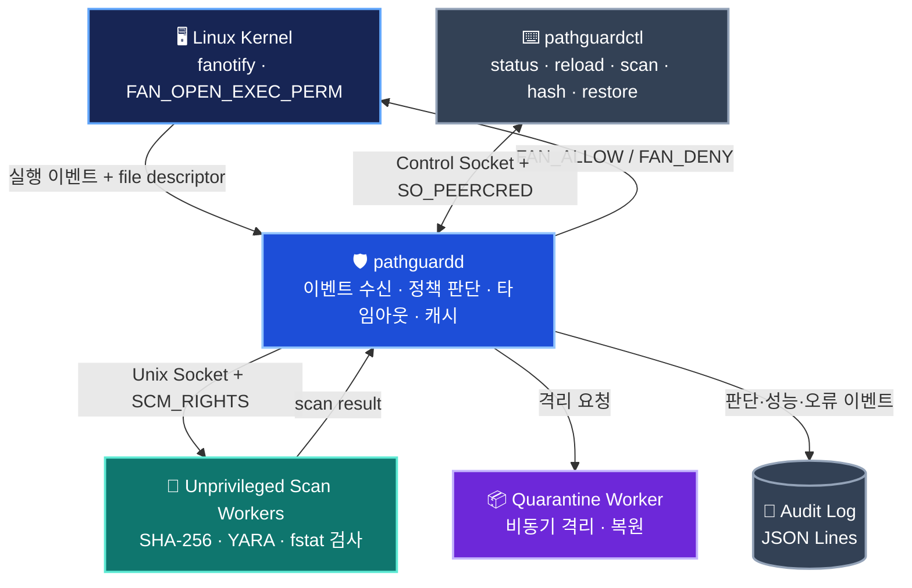
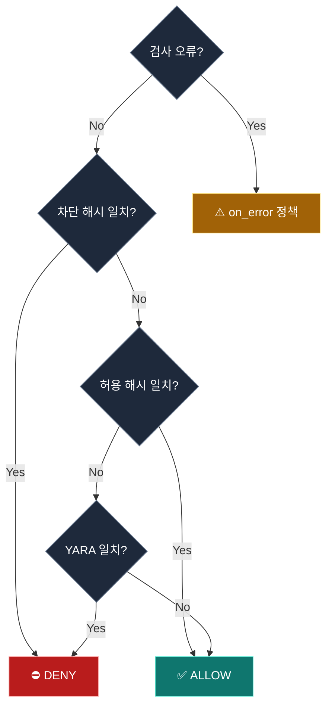

<div align="center">

# 🛡️ PathGuard

### Linux Endpoint Execution Protection Agent

<br>

## 실행되기 전에 검사하고, 위험하면 차단한다.

**Linux 커널의 실행 권한 이벤트를 활용하여 파일을 검사하고,**  
**SHA-256 · YARA · 정책 엔진으로 실행 허용/차단을 결정하는 EPP 프로토타입**

<br>

<p>
  
  
  
  
</p>

<p>
  
  
  
  
  
</p>

<br>

[**프로젝트 소개**](#overview) · [**아키텍처**](#architecture) · [**실행 방법**](#quick-start) · [**보안 설계**](#security-design) · [**테스트**](#testing) · [**한계와 개선**](#limitations)

</div>

---

<a id="overview"></a>
## 🎯 Project Overview

> **Why PathGuard?**  
> 단순 파일 스캐너는 악성 여부를 *판단*할 수 있어도, 그 판단이 끝나기 전 실행을 *멈추지는* 못합니다.  
> PathGuard는 `fanotify(FAN_OPEN_EXEC_PERM)`로 실행 요청을 보류하고 검사 결과를 커널에 반환하는 메커니즘을 구현합니다.

PathGuard는 **Linux EPP(Endpoint Protection Platform)의 실행 방어 경로**를 직접 설계·구현하고, 탐지 성능뿐 아니라 **TOCTOU, 권한 분리, 장애 상황, 성능 비용**까지 검증하는 보안 엔지니어링 프로젝트입니다.

<table>
<tr>
<td width="25%" align="center"><strong>🔒 PREVENT</strong><br><sub>fanotify 권한 이벤트<br>실행 허용·차단</sub></td>
<td width="25%" align="center"><strong>🔎 DETECT</strong><br><sub>SHA-256 정책<br>YARA 규칙 검사</sub></td>
<td width="25%" align="center"><strong>📦 RESPOND</strong><br><sub>비동기 격리<br>무결성 확인·복원</sub></td>
<td width="25%" align="center"><strong>📊 OBSERVE</strong><br><sub>JSONL 감사 로그<br>상태·지연시간 추적</sub></td>
</tr>
</table>

### ✨ Key Features

| 영역 | 구현 내용 |
|:---|:---|
| 🛡️ **Execution Control** | `FAN_OPEN_EXEC_PERM` 이벤트를 사용한 실행 직전 허용/거부 (`FAN_ALLOW` / `FAN_DENY`) |
| 🧬 **File Detection** | SHA-256 허용·차단 목록과 YARA 시그니처 검사 |
| ⚖️ **Policy Engine** | `enforce` / `audit` 모드, 검사 오류·대기열 초과 시 정책 분리 |
| 🧱 **Privilege Separation** | 비특권 스캔 워커와 `SCM_RIGHTS` 파일 디스크립터 전달 |
| 🚦 **Availability** | 제한된 큐, 스캔 타임아웃, 워커 재시작, 결과 캐시, 실패한 규칙 갱신 롤백 |
| 📁 **Quarantine** | 커널 응답 이후 비동기 격리, 파일 재검증, 기존 파일 덮어쓰기 없는 복원 |
| 🧾 **Auditability** | 실행 판단 원인·처리 지연·장애·보호 공백을 JSON Lines로 기록 |

> [!IMPORTANT]
> **실습·연구 목적의 EPP 프로토타입**입니다. 상용 EPP 수준의 전체 공격면 보호, root 공격자에 대한 변조 방지, 에이전트 종료 후 fail-closed 동작을 보장하지 않습니다.

---

<a id="architecture"></a>
## 🏗️ Architecture

<div align="center">
  <strong>Kernel Event → Agent → Isolated Scanner → Policy Decision → Response</strong>
  <p><sub>커널에서 실행 요청을 잠시 멈추고, 사용자 영역에서 탐지·판단한 뒤 결과를 반환합니다.</sub></p>
</div>



### 🔁 Execution Flow

1. **Intercept** — 커널이 감시 대상 실행 파일의 권한 이벤트와 fd를 에이전트에 전달합니다.
2. **Inspect** — 캐시를 확인하고 필요한 경우 비특권 워커에 fd를 전달해 SHA-256·YARA 검사를 수행합니다.
3. **Validate** — 검사 전후 `(dev, ino, size, mtime, ctime)` 메타데이터를 비교해 파일 변경을 탐지합니다.
4. **Decide** — 해시 목록·YARA·오류 처리 정책으로 실행 여부를 판단합니다.
5. **Enforce** — 에이전트가 커널에 `FAN_ALLOW` 또는 `FAN_DENY`를 반환합니다.
6. **Respond** — 판단을 감사 로그로 남기고 필요하면 별도 워커에서 비동기 격리를 수행합니다.

**설계 포인트:** 경로를 다시 열어 검사하는 대신, **커널이 전달한 동일 fd를 검사 워커로 넘깁니다.** 이는 경로 기반 재오픈에서 발생할 수 있는 TOCTOU 위험을 완화하기 위한 선택입니다.

<details>
<summary><strong>📂 핵심 소스 코드 바로가기</strong></summary>

| 컴포넌트 | 코드 |
|:---|:---|
| 커널 이벤트·워커 관리 | [`src/agent/agent.cpp`](src/agent/agent.cpp) |
| 비특권 검사 워커 | [`src/agent/worker_main.cpp`](src/agent/worker_main.cpp) |
| SHA-256 · YARA | [`src/scanner/scanner.cpp`](src/scanner/scanner.cpp) |
| 정책 엔진 | [`src/policy/policy.cpp`](src/policy/policy.cpp) |
| 격리·복원 | [`src/quarantine/store.cpp`](src/quarantine/store.cpp), [`src/agent/quarantine_worker.cpp`](src/agent/quarantine_worker.cpp) |
| 감사 로그 | [`src/common/audit_log.cpp`](src/common/audit_log.cpp) |
| 관리 API·CLI | [`src/agent/control.cpp`](src/agent/control.cpp), [`src/cli/main.cpp`](src/cli/main.cpp) |

</details>

---

<a id="quick-start"></a>
## 🚀 Quick Start

### 01. Requirements

| 항목 | 요구 사항 |
|:---|:---|
| OS | `fanotify` 실행 권한 이벤트를 지원하는 Linux (실습 기준 Ubuntu 22.04 / 24.04 VM) |
| Build | C++17 · CMake 3.16+ · `libyara-dev` · `libssl-dev` · `pkg-config` |
| Runtime | fanotify 감시 등록에 필요한 권한 · `systemd` |

> [!CAUTION]
> 실행 차단 및 파일 격리가 실제로 수행됩니다. **운영 서버가 아닌 격리된 테스트 VM**에서 검증하세요. Docker 빌드 성공만으로 실제 실행 차단 기능이 검증되지는 않습니다.

### 02. Build

```bash
git clone https://github.com/path0971/PathGuard.git
cd PathGuard

sudo apt update
sudo apt install -y build-essential cmake pkg-config libyara-dev libssl-dev

cmake -S . -B build
cmake --build build -j
ctest --test-dir build --output-on-failure
```

### 03. Install & Start

```bash
# 격리된 테스트용 ext4 파일 시스템 준비
sudo tests/vm/setup_testfs.sh

# 바이너리·설정·systemd 서비스 설치
sudo scripts/install.sh

# 시작 전 설정 검증
sudo pathguardd --check

# 서비스 시작 및 상태 확인
sudo systemctl enable --now pathguard
sudo pathguardctl status
```

설치 시 기본 설정 파일 [`config/pathguard.conf`](config/pathguard.conf)을 `/etc/pathguard/pathguard.conf`에 배치합니다. 기존 설정이 있으면 설치 스크립트가 이를 보존합니다.

> [!NOTE]
> 기본 `watch_path`는 마운트 지점이어야 하며 `/` 감시는 차단됩니다. `allow_non_mountpoint`, `allow_root_filesystem` 예외 설정이 있지만, 검증 초기에는 사용을 권장하지 않습니다.

### 04. Verify

```bash
# 실행 통제·탐지·격리·장애 대응 E2E 테스트
sudo tests/vm/e2e.sh

# 벤치마크: 실행 지연 p50/p95 · CPU · RSS
sudo ITER=200 tests/vm/bench.sh
```

### 05. Uninstall

```bash
# 설정·로그·격리 저장소는 보존
sudo scripts/uninstall.sh
```

`--purge`는 보존 데이터를 삭제할 수 있으므로 실행 전 반드시 확인하세요.

---

<a id="policy"></a>
## ⚙️ Detection & Policy

<div align="center">

**SHA-256 Blacklist → SHA-256 Allowlist → YARA → Default Allow**

<sub>검사 실패는 별도의 오류 정책으로 처리되며, 정상 결과로 취급하지 않습니다.</sub>

</div>



| 정책 | 동작 |
|:---|:---|
| 🟥 `enforce` | 탐지 결과에 따라 실행을 실제 차단할 수 있음 |
| 🟨 `audit` | 차단 대상으로 판정해도 실행은 허용하고 판단 근거를 기록 |
| 🟧 `on_error` | 파일 검사 실패 시 허용 또는 차단 선택 |
| 🟦 `on_overflow` | 검사 큐 초과 시 허용 또는 차단 선택 |

**저장소 기본 설정 예시:**

```ini
mode = enforce
on_error = allow
on_overflow = allow

watch_path = /mnt/pg-test
mark_type = filesystem
workers = 2
queue_max = 256
scan_timeout_ms = 2000
max_file_size = 64M
cache_max = 4096
quarantine = true
```

> [!WARNING]
> `on_error=allow`, `on_overflow=allow`는 가용성을 고려한 설정입니다. **검사 실패나 큐 초과 시 실행이 허용될 수 있습니다.** 반대로 `deny`로 구성하면 업무 가용성에 영향을 줄 수 있습니다. 에이전트 자체가 종료된 뒤의 fail-closed 보장은 제공하지 않습니다.

---

<a id="security-design"></a>
## 🔐 Security Engineering

PathGuard의 핵심은 단순한 탐지 로직보다 **실행 차단 시스템이 직면하는 보안·운영 트레이드오프**를 코드 수준에서 다뤘다는 점입니다.

| Engineering Challenge | Design Choice | 남은 위험·제약 |
|:---|:---|:---|
| ⏱️ **TOCTOU** | 경로 재오픈 대신 커널 fd 검사, 검사 전후 메타데이터 비교 | 격리 직전 재검증과 삭제 사이 경쟁 조건 |
| 🧱 **Least Privilege** | 스캔 워커를 `pathguard` 사용자로 실행, `SCM_RIGHTS`로 fd 전달 | seccomp 기반 추가 격리는 미구현 |
| 🧵 **Concurrency** | 제한된 큐와 워커 수, 스캔 기한에 큐 대기시간 포함 | 과부하 시 오류 정책에 따른 실행 허용 가능성 |
| 🔄 **Fault Tolerance** | 워커 재기동, 반복 장애 시 백오프, 미응답 요청 오류 처리 | 에이전트 종료 후 보호 공백 |
| ♻️ **Rule Reload** | 새 워커 세대에서 규칙 준비 후 교체, 실패 시 기존 규칙 유지 | 서명된 중앙 정책 배포는 미구현 |
| ⚡ **Performance** | 메타데이터 기반 캐시, 규칙 갱신 시 캐시 무효화 | 타임스탬프 정밀도 등에 따른 캐시 한계 |
| 📦 **Quarantine** | 커널 응답 후 비동기 격리, 파일 동일성·해시 재확인 | 하드 링크·경쟁 조건 잔존 |

### 🧩 Privilege Separation

- **Privileged agent:** fanotify 등록, 실행 허용/차단, 워커·큐 관리
- **Unprivileged workers:** 파일 해시와 YARA 검사 (`pathguard` 계정)
- **IPC:** Unix Domain `SOCK_SEQPACKET` + `SCM_RIGHTS`
- **Worker hardening:** 그룹·불필요 권한 제거, `NO_NEW_PRIVS`, 리소스 제한
- **Control interface:** `/run/pathguard/control.sock`, 호출자 확인에 `SO_PEERCRED` 사용

`root`는 모든 관리 명령을 사용할 수 있으며, `pathguard-admin`은 상태 및 격리 목록 조회 권한으로 제한됩니다.

### 🛠️ Management CLI

```bash
sudo pathguardctl status
sudo pathguardctl reload
sudo pathguardctl quarantine list
sudo pathguardctl quarantine restore <ID> [--to PATH]

# 오프라인 검사: exit code 0=allow, 1=deny, 2=error
sudo pathguardctl scan FILE...

# 해시 목록 작성용 SHA-256 출력
sudo pathguardctl hash FILE...
```

### 🧾 Audit Log

기본 저장 위치: `/var/log/pathguard/audit.jsonl`

```json
{
  "type": "exec_decision",
  "decision": "deny",
  "policy_decision": "deny",
  "reason": "yara_match",
  "scan_result": "match",
  "source": "scan",
  "path": "/mnt/pg-test/pg-tests/marked"
}
```

위 JSON은 **핵심 필드만 보여주는 구조 예시**입니다. 실제 이벤트에는 PID, 파일 식별자, 해시, 규칙명, 워커 PID, `scan_us`, `latency_us`, `queue_wait_us` 등의 필드가 포함될 수 있습니다. 에이전트 시작·종료, 규칙 갱신 실패, 워커 장애, 보호 공백도 기록합니다.

---

<a id="testing"></a>
## 🧪 Validation & Benchmark

### Test Coverage

| 검증 레벨 | 명령 | 확인 대상 |
|:---|:---|:---|
| 🧩 Unit | `ctest --test-dir build --output-on-failure` | 해시, 설정, 정책, 스캐너, 격리·복원 |
| 🧪 E2E | `sudo tests/vm/e2e.sh` | 커널 실행 차단, YARA·해시, 캐시, 오류·장애·격리·복원 |
| 📈 Benchmark | `sudo ITER=200 tests/vm/bench.sh` | 파일 크기별 p50/p95 실행 지연, CPU, RSS |

### Performance Snapshot

<div align="center">


</div>

기존 저장소에 기록된 실험 결과를 요약했습니다. **Docker Desktop의 WSL2 커널 6.18, 22 CPU, privileged 컨테이너, loop ext4** 환경에서 파일 크기별 100회 측정한 수치로, Ubuntu VM·실제 운영환경의 성능을 의미하지 않습니다.

| 파일 크기 | 보호 미적용 p50 | 최초 검사 p50 / p95 | 캐시 적중 p50 | 에이전트 판단 p50 |
|:---:|---:|---:|---:|---:|
| **16 KB** | 402 µs | **514 / 650 µs** | 421 µs | 100 µs |
| **1 MB** | 416 µs | **2,111 / 2,664 µs** | 425 µs | 1,637 µs |
| **10 MB** | 395 µs | **16,932 / 18,290 µs** | 471 µs | 16,082 µs |
| **50 MB** | 384 µs | **97,189 / 109,110 µs** | 546 µs | 96,168 µs |

> **관찰 결과:** 최초 검사는 파일 크기에 비례해 지연이 증가했지만, 변경되지 않은 파일의 **캐시 적중 시 실행 지연은 크게 감소**했습니다. 기존 실험에는 에이전트 최대 RSS 약 8 MB, 워커 최대 RSS 약 78 MB(50 MB 파일 버퍼 포함)가 기록되어 있습니다.

> [!NOTE]
> 위 수치는 **기존 측정 기록**이며 이 README를 작성하면서 재실행한 결과가 아닙니다. 별도 Ubuntu VM 및 실제 배포 대상 파일 시스템에서 동일 테스트를 재현해 검증할 필요가 있습니다.

---

<a id="limitations"></a>
## 🧭 Limitations & Roadmap

<table>
<tr><th align="left">현재 제한사항</th><th align="left">후속 개선 방향</th></tr>
<tr><td>🔸 에이전트 종료 시 fail-closed 실행 통제 불가</td><td>프로세스 종료·보호 공백에 대한 운영 대응 강화</td></tr>
<tr><td>🔸 인터프리터 스크립트 및 메모리 기반 실행 미보호</td><td><code>FAN_OPEN_PERM</code> 등 확장 검토</td></tr>
<tr><td>🔸 감시 대상 파일 시스템에만 적용</td><td>다양한 파일 시스템·컨테이너 환경 검증</td></tr>
<tr><td>🔸 root 공격자에 대한 완전한 변조 방지 미구현</td><td>권한 모델·자기 보호 강화 연구</td></tr>
<tr><td>🔸 격리 과정의 TOCTOU·하드 링크 위험 잔존</td><td>격리 경로 검증 및 경쟁 조건 완화</td></tr>
<tr><td>🔸 중앙관리·정책 서명·행위 탐지 미구현</td><td>정책 배포·로그 수집·추가 탐지 기능 확장</td></tr>
</table>

**보호 범위:** `watch_path`로 지정한 파일 시스템/마운트의 일반 실행 파일. `bash script.sh`, `python script.py` 등 인터프리터가 읽는 스크립트, `memfd_create` 같은 메모리 실행, 감시 범위 밖 실행은 현재 보호하지 않습니다.

<details>
<summary><strong>🗂️ Repository Structure</strong></summary>

```text
PathGuard/
├── config/              # 기본 정책·SHA-256 목록
├── docker/              # 컨테이너 빌드·단위 테스트
├── packaging/           # systemd 서비스
├── rules/               # YARA 탐지 규칙
├── scripts/             # 설치·제거 스크립트
├── src/
│   ├── agent/           # fanotify 이벤트·워커·관리 소켓
│   ├── cli/             # pathguardctl
│   ├── common/          # 설정·해시·JSON·감사 로그
│   ├── policy/          # 정책 엔진
│   ├── quarantine/      # 격리·복원
│   └── scanner/         # 해시·YARA 검사
├── tests/
│   ├── unit/            # 단위 테스트
│   └── vm/              # E2E·성능 테스트·전용 테스트 FS
├── CMakeLists.txt
└── README.md
```

</details>

---

<div align="center">

### 🛡️ PathGuard

**Prevent before execution. Detect with evidence. Respond with control.**

<sub>Linux Security Engineering · Kernel Event Handling · Endpoint Protection</sub>

<br><br>

<a href="https://github.com/path0971/PathGuard">
  
</a>

<br><br>

<sub>⚠️ 실습·연구용 소프트웨어입니다. 운영환경 배포 전 커널 호환성, 정책, 권한 및 장애 조건을 별도 검증하세요.</sub>

</div>
